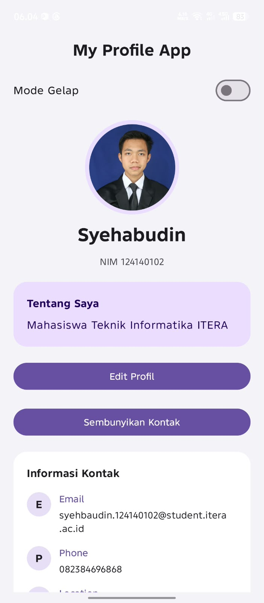
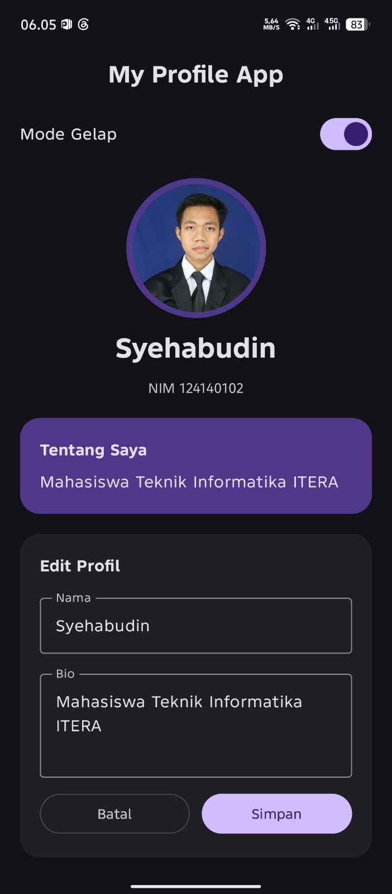
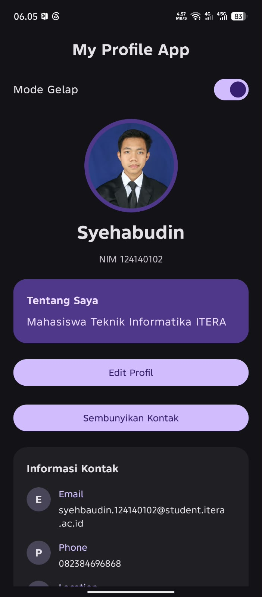

# My Profile App - MVVM
Tugas Praktikum Pertemuan 4: State Management dan MVVM  
Pengembangan Aplikasi Mobile  

**Nama:** Syehabudin  
**NIM:** 124140102  
**Kelas:** RB
## Deskripsi

Proyek ini mengembangkan Profile App dari tugas praktikum 3. Foto, NIM, kartu bio, dan informasi kontak tetap digunakan. Fitur baru berupa edit nama dan bio serta switch mode gelap.

Data profil, isi form, dan pilihan tema dikelola oleh `ProfileViewModel` menggunakan `StateFlow<ProfileUiState>`. Nama dan bio di halaman profil diperbarui setelah tombol **Simpan** ditekan. Tombol **Batal** membuang perubahan dalam form. Nama yang kosong akan ditolak.
## Cara Menjalankan di Android Studio
1. Buka proyek di Android Studio folder yang telah di siapkan.
2. Tunggu Gradle Sync selesai. Jika Android Studio meminta pemasangan SDK sesuai proyek, ikuti permintaan tersebut.
3. Gunakan JDK sesuai konfigurasi Gradle proyek. File `gradle/gradle-daemon-jvm.properties` yang sudah ada menetapkan JDK 21.
4. Pilih konfigurasi **androidApp** dan pilih emulator atau HP dengan USB debugging aktif.
5. Klik **Run**. Nama aplikasi tetap **My Profile App**.

## Build dan Tes
Jalankan dari terminal di folder utama proyek:

```powershell
.\gradlew.bat :androidApp:assembleDebug
.\gradlew.bat :shared:testAndroidHostTest
```

Untuk hanya menjalankan empat tes profil baru:

```powershell
.\gradlew.bat :shared:testAndroidHostTest --tests "com.example.tugaspraktikum2_pam.ProfileViewModelTest"
```

## Screenshots
### Tampilan Profil


### Form Edit Profil


### Dark Mode
